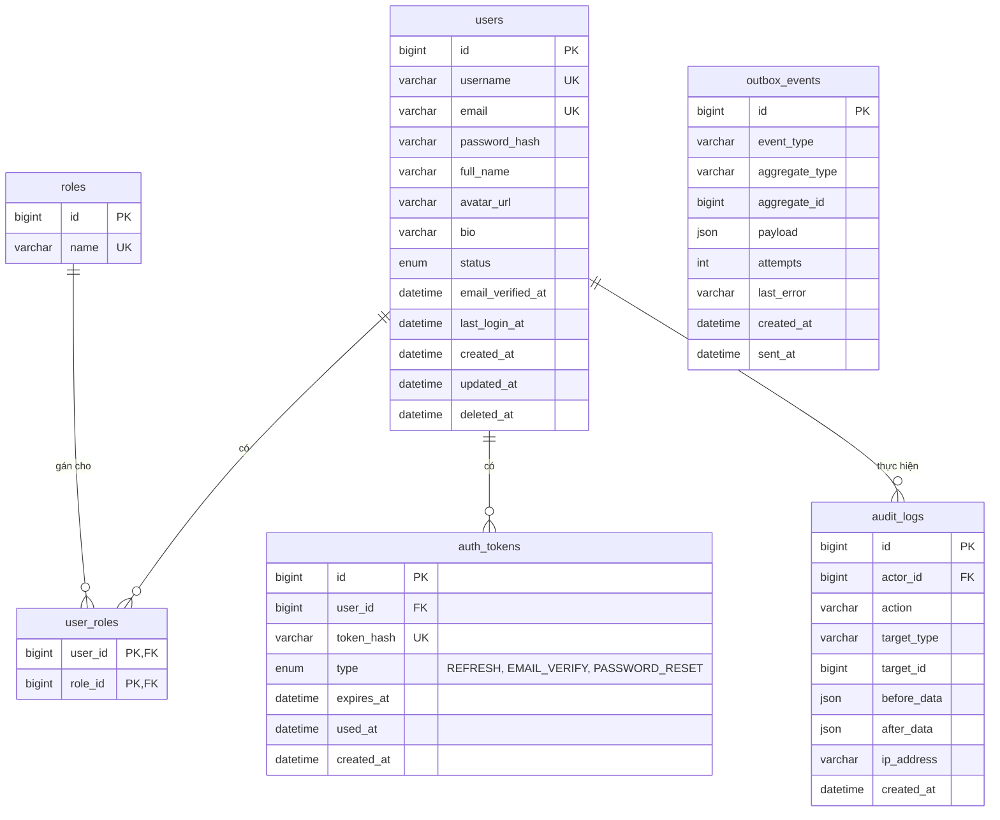
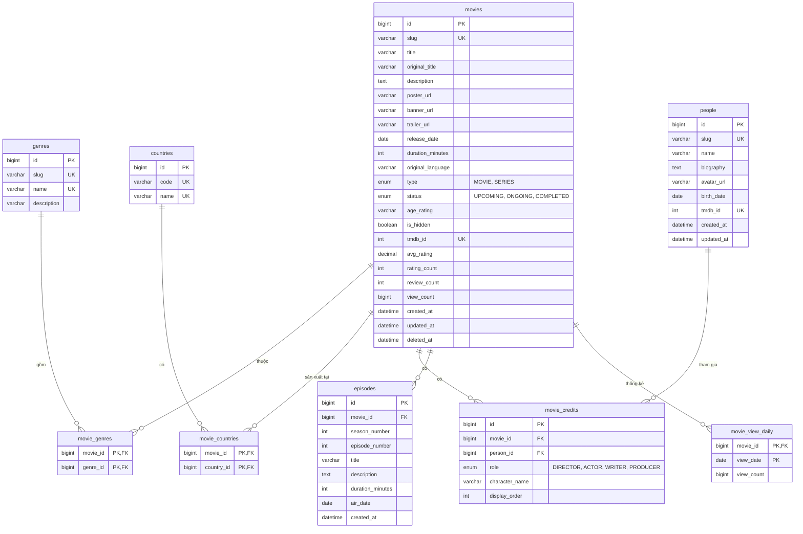
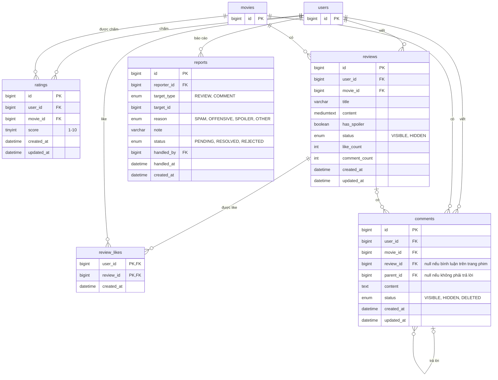
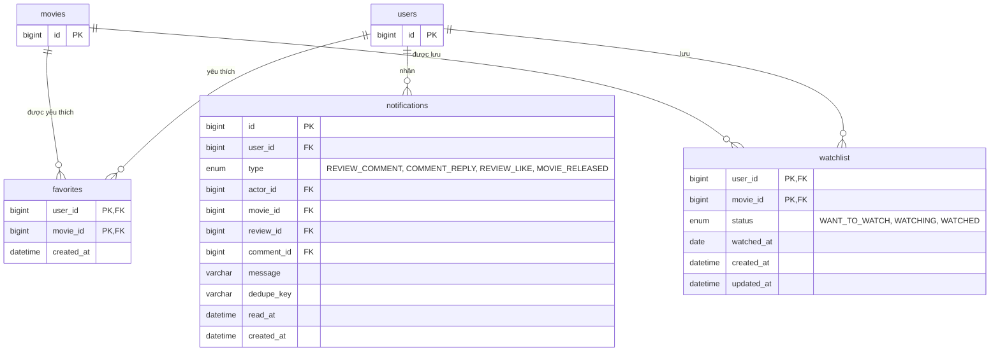

# Tổng hợp toàn bộ API Dự án Review Phim

Stack: Java + Spring Boot (backend), React thuần + Vite (frontend), MySQL, Redis, MinIO/S3, RabbitMQ.

Website cho phép tra cứu thông tin phim, chấm điểm, viết bài review, bình luận và lưu danh sách phim cá nhân. Website không phát video.


## 1. Danh sách API

### 1.1. Tổng quan

| Module                 | API       | Ghi chú                                                                 |
| ---------------------- | --------: | ----------------------------------------------------------------------- |
| Authentication         |         8 | register, login, refresh, logout, forgot/reset password, verify/gửi lại email |
| User / Profile         |         6 | xem, sửa profile, đổi mật khẩu, đổi avatar, trang cá nhân công khai, review của một user |
| Movie (Phim)           |         6 | list + search + lọc, chi tiết, trending, trạng thái cá nhân, danh sách tập, ghi nhận view |
| Genre (Thể loại)       |         2 | list, chi tiết                                                          |
| Country (Quốc gia)     |         1 | list                                                                    |
| People (Đạo diễn, diễn viên) |   2 | list + search, chi tiết kèm danh sách phim đã tham gia                  |
| Review                 |         8 | list, chi tiết, viết, sửa, xóa, like, bỏ like, báo cáo                  |
| Rating                 |         3 | chấm điểm, xóa điểm, xem điểm + phân bố                                 |
| Comment                |         7 | list theo phim, list theo review, bình luận phim, bình luận review, sửa, xóa, báo cáo |
| Favorite               |         3 | thêm, bỏ, danh sách yêu thích                                           |
| Watchlist              |         3 | đặt trạng thái muốn xem / đang xem / đã xem, bỏ, danh sách              |
| Notification           |         4 | list, số chưa đọc, đánh dấu đã đọc, đọc tất cả                          |
| Admin Movie            |        10 | list, chi tiết, tạo, sửa, xóa, ẩn/hiện, đổi poster, đổi banner, tìm trên TMDB, import từ TMDB |
| Admin Credit & Episode |         5 | cập nhật ê-kíp, danh sách, thêm, sửa, xóa tập phim                      |
| Admin People           |         4 | tạo, sửa, xóa, đổi ảnh                                                  |
| Admin Genre            |         3 | tạo, sửa, xóa                                                           |
| Admin User             |         3 | list, khóa/mở khóa, đổi role                                            |
| Admin Moderation       |         4 | list báo cáo, xử lý báo cáo, ẩn/hiện review, ẩn/hiện comment            |
| Dashboard              |         5 | tổng quan, top phim, lượt xem theo ngày, user mới, review theo ngày     |
| Audit Log              |         2 | list, chi tiết                                                          |
| **Tổng**               |  **89**   |                                                                         |

### 1.2. Chi tiết endpoint

Tiền tố chung: `/api/v1`. Quyền: Public = không cần đăng nhập, User = đã đăng nhập, Verified = đã đăng nhập và đã xác thực email, Admin = ROLE_ADMIN, Mod = ROLE_MODERATOR hoặc ROLE_ADMIN.

Trang công khai dùng `slug` (thân thiện SEO), các thao tác ghi dùng `id`.

**Authentication**

| Method | Endpoint                  | Quyền  | Ghi chú                                  |
| ------ | ------------------------- | ------ | ---------------------------------------- |
| POST   | /auth/register            | Public | Gửi mail xác thực                        |
| POST   | /auth/login               | Public | Có rate limit                            |
| POST   | /auth/refresh             | Public | Đọc refresh token từ cookie, cấp token mới và xoay vòng refresh token |
| POST   | /auth/logout              | User   | Thu hồi refresh token                    |
| POST   | /auth/forgot-password     | Public | Luôn trả 200 dù email có tồn tại hay không |
| POST   | /auth/reset-password      | Public | Thu hồi toàn bộ refresh token            |
| POST   | /auth/verify-email        | Public |                                          |
| POST   | /auth/resend-verification | Public | Có rate limit                            |

**User / Profile**

| Method | Endpoint                   | Quyền  | Ghi chú |
| ------ | -------------------------- | ------ | ------- |
| GET    | /users/me                  | User   |         |
| PATCH  | /users/me                  | User   | full_name, bio |
| PUT    | /users/me/password         | User   | Thu hồi các refresh token khác |
| PUT    | /users/me/avatar           | User   | multipart |
| GET    | /users/{username}          | Public | Trang cá nhân: số review, số phim đã xem, điểm trung bình đã chấm. Ẩn email |
| GET    | /users/{username}/reviews  | Public | Phân trang, chỉ review đang hiển thị |

**Movie**

| Method | Endpoint                 | Quyền  | Ghi chú |
| ------ | ------------------------ | ------ | ------- |
| GET    | /movies                  | Public | `?keyword=&genre=&country=&year=&type=MOVIE,SERIES&status=&sort=latest,release,rating,views,reviews&page=&size=` (gộp list, search, lọc). Bỏ phim ẩn và đã xóa |
| GET    | /movies/{slug}           | Public | Kèm thể loại, quốc gia, đạo diễn, diễn viên chính. Được cache nên không chứa dữ liệu riêng của user |
| GET    | /movies/trending         | Public | `?period=day,week,month` |
| GET    | /movies/{id}/me          | User   | myRating, myReview, isFavorite, watchlistStatus |
| GET    | /movies/{slug}/episodes  | Public | Chỉ với phim bộ, nhóm theo mùa |
| POST   | /movies/{id}/views       | Public | Tách khỏi GET để cache được và chống đếm trùng |

**Genre**

| Method | Endpoint       | Quyền  | Ghi chú |
| ------ | -------------- | ------ | ------- |
| GET    | /genres        | Public |         |
| GET    | /genres/{slug} | Public |         |

**Country**

| Method | Endpoint   | Quyền  | Ghi chú |
| ------ | ---------- | ------ | ------- |
| GET    | /countries | Public | Dữ liệu cố định, nạp từ file seed |

**People**

| Method | Endpoint       | Quyền  | Ghi chú |
| ------ | -------------- | ------ | ------- |
| GET    | /people        | Public | `?keyword=&page=` |
| GET    | /people/{slug} | Public | Kèm danh sách phim, nhóm theo vai trò (đạo diễn, diễn viên, biên kịch) |

**Review**

| Method | Endpoint               | Quyền    | Ghi chú |
| ------ | ---------------------- | -------- | ------- |
| GET    | /movies/{id}/reviews   | Public   | `?sort=latest,top&page=`. Trả kèm điểm của người viết (lấy từ ratings) |
| GET    | /reviews/{id}          | Public   | Trang riêng của một bài review |
| POST   | /movies/{id}/reviews   | Verified | Mỗi user một bài cho mỗi phim. Body có `title`, `content`, `hasSpoiler`, `score` tùy chọn (ghi luôn vào ratings) |
| PUT    | /reviews/{id}          | User     | Chỉ chủ bài |
| DELETE | /reviews/{id}          | User     | Chủ bài. Xóa hẳn, kéo theo comment và like của bài |
| PUT    | /reviews/{id}/like     | User     | Idempotent, không tự like bài của mình |
| DELETE | /reviews/{id}/like     | User     | Idempotent |
| POST   | /reviews/{id}/reports  | User     | Mỗi user báo cáo 1 lần |

**Rating**

| Method | Endpoint            | Quyền  | Ghi chú |
| ------ | ------------------- | ------ | ------- |
| PUT    | /movies/{id}/rating | User   | Upsert, thang điểm 1–10, 1 user 1 điểm cho mỗi phim |
| DELETE | /movies/{id}/rating | User   |         |
| GET    | /movies/{id}/rating | Public | Điểm trung bình, số lượt, số lượt theo từng mức điểm (vẽ biểu đồ) |

**Comment**

| Method | Endpoint               | Quyền    | Ghi chú |
| ------ | ---------------------- | -------- | ------- |
| GET    | /movies/{id}/comments  | Public   | Bình luận trên trang phim, `?page=` |
| GET    | /reviews/{id}/comments | Public   | Bình luận dưới bài review, `?page=` |
| POST   | /movies/{id}/comments  | Verified | Body có `parentId` (trả lời) tùy chọn |
| POST   | /reviews/{id}/comments | Verified | Body có `parentId` tùy chọn |
| PUT    | /comments/{id}         | User     | Chỉ chủ comment |
| DELETE | /comments/{id}         | User     | Chủ comment. Chuyển status = DELETED, giữ cây trả lời, hiển thị "Bình luận đã bị xóa" |
| POST   | /comments/{id}/reports | User     | Mỗi user báo cáo 1 lần |

**Favorite**

| Method | Endpoint              | Quyền | Ghi chú |
| ------ | --------------------- | ----- | ------- |
| POST   | /movies/{id}/favorite | User  | Idempotent |
| DELETE | /movies/{id}/favorite | User  | Idempotent |
| GET    | /me/favorites         | User  | Phân trang |

**Watchlist**

| Method | Endpoint                | Quyền | Ghi chú |
| ------ | ----------------------- | ----- | ------- |
| PUT    | /me/watchlist/{movieId} | User  | Upsert. Body: `status` (WANT_TO_WATCH, WATCHING, WATCHED), `watchedAt` tùy chọn |
| DELETE | /me/watchlist/{movieId} | User  | Idempotent |
| GET    | /me/watchlist           | User  | `?status=&page=` |

**Notification**

| Method | Endpoint                       | Quyền | Ghi chú |
| ------ | ------------------------------ | ----- | ------- |
| GET    | /me/notifications              | User  | Phân trang |
| GET    | /me/notifications/unread-count | User  | Badge chuông, polling 60s (SSE để sau) |
| PATCH  | /me/notifications/{id}/read    | User  |         |
| PATCH  | /me/notifications/read-all     | User  |         |

**Admin Movie**

| Method | Endpoint                       | Quyền | Ghi chú |
| ------ | ------------------------------ | ----- | ------- |
| GET    | /admin/movies                  | Admin | Gồm cả phim đang ẩn |
| GET    | /admin/movies/{id}             | Admin | Chi tiết để mở form sửa, kể cả phim đang ẩn |
| POST   | /admin/movies                  | Admin | Kèm danh sách genreIds, countryIds. Tự sinh slug nếu không gửi |
| PUT    | /admin/movies/{id}             | Admin |         |
| DELETE | /admin/movies/{id}             | Admin | Soft delete |
| PATCH  | /admin/movies/{id}/visibility  | Admin | Ẩn/hiện |
| PUT    | /admin/movies/{id}/poster      | Admin | multipart |
| PUT    | /admin/movies/{id}/banner      | Admin | multipart |
| GET    | /admin/tmdb/search              | Admin | `?query=&type=movie,tv`. Tìm trên TMDB để lấy tmdbId |
| POST   | /admin/movies/import-tmdb      | Admin | Body: `tmdbId`, `type` (movie / tv). Lấy thông tin, thể loại, quốc gia, trailer, ê-kíp (và tập phim nếu là phim bộ) rồi tạo phim ở trạng thái ẩn để admin kiểm tra. Trùng tmdb_id thì báo 409 |

**Admin Credit & Episode**

| Method | Endpoint                       | Quyền | Ghi chú |
| ------ | ------------------------------ | ----- | ------- |
| GET    | /admin/movies/{id}/episodes    | Admin | Kể cả phim đang ẩn |
| PUT    | /admin/movies/{id}/credits     | Admin | Thay toàn bộ danh sách: personId, role, characterName, displayOrder |
| POST   | /admin/movies/{id}/episodes    | Admin | Chỉ với phim bộ |
| PUT    | /admin/episodes/{id}           | Admin |         |
| DELETE | /admin/episodes/{id}           | Admin |         |

**Admin People**

| Method | Endpoint                  | Quyền | Ghi chú |
| ------ | ------------------------- | ----- | ------- |
| POST   | /admin/people             | Admin |         |
| PUT    | /admin/people/{id}        | Admin |         |
| DELETE | /admin/people/{id}        | Admin | Chặn xóa nếu còn gắn với phim |
| PUT    | /admin/people/{id}/avatar | Admin | multipart |

**Admin Genre**

| Method | Endpoint           | Quyền | Ghi chú |
| ------ | ------------------ | ----- | ------- |
| POST   | /admin/genres      | Admin |         |
| PUT    | /admin/genres/{id} | Admin |         |
| DELETE | /admin/genres/{id} | Admin | Chặn xóa nếu còn phim gắn với thể loại |

**Admin User**

| Method | Endpoint                 | Quyền | Ghi chú |
| ------ | ------------------------ | ----- | ------- |
| GET    | /admin/users             | Admin | `?keyword=&status=&role=` |
| PATCH  | /admin/users/{id}/status | Admin | Khi khóa: thu hồi toàn bộ refresh token |
| PATCH  | /admin/users/{id}/role   | Admin | Không cho tự hạ quyền chính mình |

**Admin Moderation**

| Method | Endpoint                   | Quyền | Ghi chú |
| ------ | -------------------------- | ----- | ------- |
| GET    | /admin/reports             | Mod   | `?status=PENDING&targetType=REVIEW,COMMENT` |
| PATCH  | /admin/reports/{id}        | Mod   | RESOLVED / REJECTED. Có thể ẩn luôn nội dung bị báo cáo |
| PATCH  | /admin/reviews/{id}/status | Mod   | VISIBLE / HIDDEN |
| PATCH  | /admin/comments/{id}/status | Mod  | VISIBLE / HIDDEN |

**Dashboard**

| Method | Endpoint                    | Quyền | Ghi chú |
| ------ | --------------------------- | ----- | ------- |
| GET    | /admin/dashboard/summary    | Admin | Tổng phim, user, review, báo cáo chờ xử lý |
| GET    | /admin/dashboard/top-movies | Admin | `?from=&to=&limit=&by=views,rating,reviews` |
| GET    | /admin/dashboard/views      | Admin | `?from=&to=`, đọc từ bảng movie_view_daily |
| GET    | /admin/dashboard/new-users  | Admin | `?from=&to=` |
| GET    | /admin/dashboard/reviews    | Admin | `?from=&to=`, số review mới theo ngày |

**Audit Log**

| Method | Endpoint               | Quyền | Ghi chú |
| ------ | ---------------------- | ----- | ------- |
| GET    | /admin/audit-logs      | Admin | `?actor=&action=&from=&to=` |
| GET    | /admin/audit-logs/{id} | Admin |         |


## 2. Kiến trúc

```
 ┌──────────────┐    tải ảnh trực tiếp     ┌───────────────┐
 │    React     │ ───────────────────────► │ CDN (nếu có)  │
 └──────┬───────┘                          └───────┬───────┘
        │ REST + JWT                               │
        ▼                                          │
┌──────────────────────────────────────────┐       │
│      Spring Boot (modular monolith)      │       │
│                                          │       │
│  auth · user · movie · people · review   │       │
│  social · notification · admin · audit   │       │
└───┬──────────┬──────────┬───────────┬────┘       │
    │          │          │           │            │
    ▼          ▼          ▼           ▼            │
  MySQL      Redis     RabbitMQ   MinIO / S3 ◄─────┘
                                       ▲
                       TMDB API ───────┘ (chỉ khi admin import)
```

- MySQL: dữ liệu chính, chạy MySQL80 trên máy và quản lý bằng MySQL Workbench. Redis, RabbitMQ, MinIO, Mailpit chạy bằng Docker khi dev.
- Redis: cache trang chủ/chi tiết phim, đếm view, bảng xếp hạng trending, rate limit.
- MinIO/S3: poster, banner, ảnh người, avatar. DB chỉ lưu object key, URL được ghép lúc trả về để sau này đổi CDN không phải sửa dữ liệu.
- RabbitMQ: event `comment.created`, `review.liked`, `movie.released`, consumer nằm trong module notification.
- TMDB: nguồn dữ liệu phim khi admin import. Ảnh TMDB lưu dạng URL đầy đủ, hoặc tải về MinIO nếu muốn tự chủ.
- Ảnh không đi qua Spring Boot khi người dùng xem trang, tránh nghẽn server.
- Dùng một ứng dụng duy nhất, chia package theo lớp: `controller`, `service`, `repository`, `model`, `dto`, `mapper`, `event`, `config`, `security`, `exception`, `util`. Chưa cần microservice.

### Cơ sở dữ liệu

Database `movie_web` trên MySQL 8.0.16 trở lên, gồm 23 bảng. Tạo bằng file trong thư mục `database/`: chạy `01_schema.sql` rồi `02_seed.sql` trong MySQL Workbench.

Chạy `01_schema.sql` bằng nút chạy toàn bộ script (Ctrl+Shift+Enter), không chạy từng câu. Lệnh `SET SESSION innodb_ft_enable_stopword = OFF` phải chạy cùng phiên với lệnh tạo bảng `movies`, nếu không thì tìm "Mai" sẽ không ra kết quả.

Các cột `avatar_url`, `poster_url`, `banner_url` nhận object key trên MinIO/S3 (ảnh upload) hoặc URL đầy đủ (ảnh ở nơi khác, như TMDB). Thời gian lưu theo UTC.

Tài khoản admin đầu tiên: đăng ký qua API rồi gán quyền bằng SQL.

```sql
INSERT INTO user_roles (user_id, role_id)
SELECT u.id, r.id FROM users u, roles r
WHERE u.username = 'ten_cua_ban' AND r.name = 'ROLE_ADMIN';
```

**Cụm 1: Tài khoản và hệ thống**



**Cụm 2: Nội dung phim**



**Cụm 3: Review, chấm điểm, bình luận, báo cáo**



**Cụm 4: Danh sách cá nhân và thông báo**



**Ràng buộc unique chưa hiện trên sơ đồ**

- `ratings (user_id, movie_id)`: mỗi user chấm một lần cho mỗi phim.
- `reviews (user_id, movie_id)`: mỗi user viết một bài cho mỗi phim. Bài bị admin ẩn vẫn giữ chỗ, nên user không lách bằng cách viết lại.
- `movie_credits (movie_id, person_id, role, character_name)`: một diễn viên có thể đóng nhiều vai trong một phim, nhưng không trùng cùng một vai.
- `episodes (movie_id, season_number, episode_number)`: không trùng số tập trong một mùa.
- `reports (reporter_id, target_type, target_id)`: mỗi user chỉ báo cáo một nội dung một lần.
- `notifications (user_id, dedupe_key)`: consumer chạy lại không tạo trùng thông báo.

**Chính sách xóa**

- Xóa user: xóa mềm (`deleted_at`) và ẩn danh email, họ tên. Khóa ngoại từ ratings, reviews, comments tới users là `RESTRICT` để không lỡ tay xóa hẳn làm mất nội dung và làm sai điểm trung bình.
- Xóa phim: admin xóa mềm. Nếu xóa hẳn thì review, điểm, bình luận của phim bị xóa theo.
- Xóa review: xóa hẳn, kéo theo comment và like của bài.
- Xóa comment: user xóa thì đổi status thành DELETED, giữ cây trả lời.

### Bảo mật

- Access token sống ngắn (15 phút), frontend giữ trong bộ nhớ.
- Refresh token để trong cookie HttpOnly + Secure + SameSite, xoay vòng mỗi lần refresh. DB chỉ lưu SHA-256 của token.
- Rate limit cho login, forgot-password, resend-verification, viết review, tạo comment, báo cáo.
- Chỉ user đã xác thực email mới được viết review và bình luận, hạn chế spam.
- Upload: kiểm tra định dạng thật của file (không tin đuôi file), giới hạn dung lượng, tự sinh tên file.
- Review và comment hiển thị dạng text thuần để tránh XSS. Nếu sau này cho viết Markdown thì phải lọc HTML trước khi hiển thị.
- TMDB API key để trong biến môi trường, không đưa vào frontend.

### Frontend

React thuần chạy dạng SPA (render ở trình duyệt), build bằng Vite.

- Thư viện: React Router (điều hướng), TanStack Query (gọi API + cache), Axios (interceptor tự refresh token).
- Trang chính: trang chủ (trending, mới phát hành, điểm cao), tìm kiếm + lọc, chi tiết phim (thông tin, ê-kíp, biểu đồ điểm, tab review, tab bình luận), chi tiết review, trang người (đạo diễn/diễn viên), trang cá nhân công khai, watchlist + yêu thích, thông báo, trang admin.
- Review có `hasSpoiler` thì làm mờ nội dung, người đọc bấm mới hiện.
- Khi dev: dùng proxy của Vite trỏ `/api` về Spring Boot để cookie refresh token hoạt động mà không vướng CORS.
- Khi deploy: phục vụ frontend và API cùng domain, cấu hình mọi đường dẫn không phải file tĩnh trả về `index.html` để F5 không bị 404.
- Hạn chế SEO của SPA: đặt title/description cho từng trang bằng thẻ `<title>`, `<meta>` của React, làm thêm sitemap.xml. Nếu sau này cần SEO mạnh hơn thì thêm prerender cho trang phim và trang review.


## 3. Nghiệp vụ

### 3.1. Luồng người xem

Xem thông tin phim và đọc review không cần đăng nhập. JWT chỉ cần cho các bước tương tác (User).

```
Trang chủ (Redis cache: trending, mới phát hành, điểm cao)
 ↓
Tìm kiếm / lọc theo thể loại, quốc gia, năm
 ↓
Chi tiết phim
   GET /movies/{slug}       (cache, dữ liệu chung)
   GET /movies/{id}/me      (User: điểm của tôi, watchlist, yêu thích)
 ↓
Tăng view: POST /movies/{id}/views
   Redis SET NX theo (phim + user/IP) để chống đếm trùng, TTL 1 giờ
   Redis INCR + ZINCRBY (bảng xếp hạng trending)
   Job 5 phút gom ghi xuống movies.view_count và movie_view_daily
 ↓
Đọc review, bình luận
 ↓
(User) Thêm vào watchlist / yêu thích
 ↓
(Verified) Chấm điểm, viết review, bình luận
```

### 3.2. Luồng chấm điểm và viết review

```
JWT (đã xác thực email)
 ↓
PUT /movies/{id}/rating hoặc POST /movies/{id}/reviews (kèm score)
 ↓
Trong cùng một @Transactional:
   upsert ratings / insert reviews
   cập nhật movies.avg_rating, rating_count, review_count
   (tính lại bằng AVG/COUNT từ bảng gốc trong một câu UPDATE,
    không cộng dồn để tránh lệch số khi nhiều người chấm cùng lúc)
 ↓
Nếu là review: watchlist của user cho phim này chuyển sang WATCHED
 ↓
Xóa cache chi tiết phim (hoặc để TTL ngắn vài phút)
```

- Job chạy hằng đêm tính lại toàn bộ cột tổng hợp (avg_rating, rating_count, review_count, like_count, comment_count) để sửa lệch nếu có.
- Like review và bình luận cũng cập nhật `like_count`, `comment_count` trong cùng transaction, rồi ghi outbox để tạo thông báo cho tác giả.

### 3.3. Luồng thông báo

```
Thao tác gốc ghi outbox_events trong cùng @Transactional:
   comment.created  → báo cho tác giả review / tác giả comment được trả lời
   review.liked     → báo cho tác giả review
   movie.released   → báo cho người có phim trong watchlist trạng thái WANT_TO_WATCH
 ↓
Job đọc outbox (sent_at IS NULL), gửi sang RabbitMQ, thất bại thì tăng attempts
 ↓
Consumer tạo Notification theo lô
   (idempotent nhờ unique dedupe_key, lỗi thì retry rồi vào DLQ)
   Không tạo thông báo khi người gây ra chính là người nhận
```

- `movie.released` được phát khi admin đổi status từ UPCOMING sang ONGOING/COMPLETED, hoặc khi job hằng ngày thấy `release_date` đã tới.

### 3.4. Luồng admin thêm phim

```
JWT (ROLE_ADMIN)
 ↓
Cách 1: POST /admin/movies/import-tmdb với tmdbId
   gọi TMDB lấy thông tin, thể loại, quốc gia, đạo diễn, diễn viên
   tạo people nếu chưa có (so theo tmdb_id)
Cách 2: POST /admin/movies nhập tay
 ↓
Phim được tạo ở trạng thái ẩn (is_hidden = true)
 ↓
Upload poster / banner lên MinIO/S3 (nằm ngoài transaction DB)
 ↓
Cập nhật ê-kíp (PUT /admin/movies/{id}/credits), thêm tập nếu là phim bộ
 ↓
Hiện phim (PATCH /admin/movies/{id}/visibility)
 ↓
Xóa cache trang chủ + chi tiết phim
```

- Audit Log ghi cho mọi thao tác ghi của admin và moderator. Service gọi `AuditService.record` trong cùng transaction để lưu được dữ liệu trước/sau và thao tác lỗi thì không có log.
- Job dọn ảnh mồ côi: file trên MinIO/S3 không còn được phim, người hay user nào tham chiếu, do upload lỗi giữa chừng hoặc đã đổi ảnh khác.


## 4. Tình trạng backend (`film/back_end`)

Đã có đủ 89 API. Cần MySQL, Redis, RabbitMQ, MinIO; Redis, RabbitMQ hoặc MinIO tắt thì app vẫn chạy (xem bảng).

| Phần | Cách làm | Khi dịch vụ đó tắt |
| ---- | -------- | ------------------ |
| Cache | Redis, JSON. Chi tiết phim 5 phút, danh sách phim 5 phút (chỉ khi không có từ khóa), thể loại / quốc gia 1 giờ. Admin sửa phim thì xóa cache chi tiết và tăng phiên bản `cache:movies:ver` để mọi trang danh sách cũ hết hiệu lực. Chấm điểm / review xóa cache chi tiết phim đó | Đọc thẳng DB |
| Đếm view | `SET NX` theo (phim + user/IP) hạn 1 giờ, `HINCRBY views:pending:{ngày}`, `ZINCRBY trending:{ngày}`. Job 5 phút gom ghi xuống `movies.view_count` và `movie_view_daily` | Không tính lượt xem đó |
| Trending | `trending:{ngày}`, tuần / tháng gộp bằng `ZUNIONSTORE` (cache 1 phút) | Đọc `movie_view_daily` |
| Rate limit | Lua script `INCR` + `PEXPIRE` trên khóa `rl:*`, đúng cả khi chạy nhiều instance | Cho qua (fail-open) |
| Event → thông báo | `OutboxPublisher` khóa dòng bằng `FOR UPDATE SKIP LOCKED`, gửi lên exchange `film.events` (routing key = event_type), chờ publisher confirm rồi mới đánh dấu đã gửi. `NotificationEventListener` nhận từ queue `film.notification`, lỗi thử lại 3 lần rồi vào `film.notification.dlq` | Event nằm chờ trong outbox, broker lên lại thì gửi tiếp |
| Lưu ảnh | `S3StorageService` (AWS SDK, dùng được cho MinIO và S3 thật). Tự tạo bucket `movie-web` cho đọc công khai, trình duyệt tải ảnh thẳng từ MinIO / CDN. Key dạng `posters/{uuid}.jpg`, Cache-Control 1 năm. Ảnh cũ chỉ bị xóa sau khi transaction commit, ảnh mới bị xóa nếu rollback. Job 04:00 UTC xóa ảnh không còn bảng nào trỏ tới (cũ hơn 24 giờ). Đặt `STORAGE_TYPE=local` để lưu vào thư mục `uploads/` mà không cần MinIO | Upload báo 503 `STORAGE_UNAVAILABLE`, các trang khác vẫn chạy |

Chạy backend khi dev:

1. Tạo DB bằng `database/01_schema.sql`, `02_seed.sql`.
2. Ghi mật khẩu MySQL và JWT secret vào `src/main/resources/application-local.properties` (đã gitignore). Muốn import phim từ TMDB thì thêm `app.tmdb.read-token=...` (API Read Access Token lấy tại https://www.themoviedb.org/settings/api); không có key thì các chức năng khác vẫn chạy, chỉ import báo 503.
3. `docker compose up -d` trong `film/back_end` để chạy Redis, RabbitMQ (quản lý tại http://localhost:15672, guest / guest), MinIO (quản lý tại http://localhost:9001, minioadmin / minioadmin) và Mailpit (xem mail tại http://localhost:8025).
4. Chạy `FilmApplication` (cổng 8081), Swagger tại http://localhost:8081/swagger-ui.html.

## Tình trạng frontend (`film/font_end`)

React 19 + Vite, React Router, TanStack Query, Axios. Không dùng thư viện UI, CSS viết tay trong `src/styles.css` (theme tối, có responsive cho điện thoại).

| Nhóm | Trang |
| ---- | ----- |
| Xem phim | Trang chủ (`/`), danh sách + lọc (`/phim`), chi tiết phim (`/phim/:slug`), review (`/review/:id`), người (`/nguoi`, `/nguoi/:slug`), trang cá nhân (`/u/:username`) |
| Tài khoản | Đăng nhập, đăng ký, quên / đặt lại mật khẩu, xác thực email, cài đặt (`/tai-khoan`), watchlist, yêu thích, thông báo |
| Quản trị (`/admin`) | Tổng quan, phim (form + upload poster / banner + ê-kíp + tập phim), người, thể loại, người dùng, báo cáo vi phạm (moderator cũng vào được), audit log |

- Access token chỉ nằm trong bộ nhớ; F5 thì gọi `/auth/refresh` bằng cookie để khôi phục phiên. Gặp 401 thì tự refresh một lần rồi gửi lại request (`src/api/client.js`).
- Bộ lọc danh sách phim nằm trên URL nên chia sẻ link và bấm Back được.
- Review có spoiler bị làm mờ; review và bình luận hiển thị dạng text thuần.
- Đường dẫn `/verify-email` và `/reset-password` khớp với link backend gửi trong email.

Chạy frontend khi dev (cần backend ở cổng 8081):

```bash
cd film/font_end
npm install
npm run dev
```

Mở http://localhost:5173. Vite chuyển `/api` sang Spring Boot nên cookie refresh token hoạt động mà không vướng CORS. Backend chạy cổng khác thì tạo `film/font_end/.env.local` với dòng `VITE_API_TARGET=http://localhost:<cổng>`.


## Deploy (Docker)

Mỗi phần có Dockerfile riêng; `docker-compose.prod.yml` ở thư mục gốc chạy toàn bộ trên một server.

```
 Internet ──► Caddy :443 (HTTPS, tùy chọn) ──► nginx (frontend)
                                               ├─ /        file tĩnh React
                                               ├─ /api/    ──► backend :8081 ──► MySQL, Redis, RabbitMQ, MinIO
                                               └─ /media/  ──► MinIO (bucket movie-web, chỉ đọc)
```

- Chỉ nginx (hoặc Caddy) mở cổng ra ngoài; MySQL, Redis, RabbitMQ, MinIO nằm trong mạng nội bộ Docker.
- Lần đầu chạy, MySQL tự tạo bảng và dữ liệu danh mục từ `database/`. Các lần sau không chạy lại (thay đổi schema về sau cần migration, nên dùng Flyway).
- Backend: image JRE 21 Alpine, chạy bằng user thường, healthcheck `/actuator/health/liveness`, tắt Swagger.
- Frontend: nginx phục vụ SPA (F5 không 404), gzip, cache 1 năm cho file có hash, header bảo mật, giới hạn upload 6MB.

### Lên server (Ubuntu, có domain)

1. Cài Docker: https://docs.docker.com/engine/install/ubuntu/
2. Trỏ bản ghi DNS A của domain về IP server, mở cổng 80 và 443.
3. Đưa code lên server (git clone), rồi tạo file cấu hình:
   ```bash
   cp .env.example .env
   ```
   Điền mật khẩu, `JWT_SECRET` (sinh bằng `openssl rand -base64 48`), `PUBLIC_URL=https://<domain>`, `DOMAIN=<domain>`, `FRONTEND_BIND=127.0.0.1:8080`, thông tin SMTP.
4. Chạy:
   ```bash
   docker compose -f docker-compose.prod.yml --profile https up -d --build
   ```
   Caddy tự lấy chứng chỉ Let's Encrypt.
5. Đăng ký tài khoản trên web rồi cấp quyền admin:
   ```bash
   docker compose -f docker-compose.prod.yml exec mysql sh -c 'mysql -uroot -p"$MYSQL_ROOT_PASSWORD" movie_web -e "INSERT INTO user_roles (user_id, role_id) SELECT u.id, r.id FROM users u, roles r WHERE u.username=\"ten_cua_ban\" AND r.name=\"ROLE_ADMIN\""'
   ```

Chưa có domain, chạy thử bằng IP: đặt `PUBLIC_URL=http://<ip>`, `FRONTEND_BIND=80`, `COOKIE_SECURE=false` và bỏ `--profile https`. Không dùng cách này lâu dài vì mật khẩu đi qua HTTP không mã hóa.

### Vận hành

| Việc | Lệnh |
| ---- | ---- |
| Cập nhật code mới | `git pull` rồi `docker compose -f docker-compose.prod.yml --profile https up -d --build` |
| Xem log backend | `docker compose -f docker-compose.prod.yml logs -f backend` |
| Sao lưu DB | `docker compose -f docker-compose.prod.yml exec mysql sh -c 'mysqldump -uroot -p"$MYSQL_ROOT_PASSWORD" movie_web' > backup.sql` |
| Sao lưu ảnh | sao lưu volume `reviewfilm_minio-data` |

Lưu ý: Docker network dùng dải cố định `172.30.0.0/24` để Caddy có IP cố định (nginx chỉ tin header `X-Forwarded-For` từ đúng IP này). Nếu dải này trùng mạng khác trên server thì đổi trong `docker-compose.prod.yml` và `film/font_end/nginx.conf`.


## 5. Thứ tự code đề xuất

Làm theo từng module trọn vẹn (entity → repository → DTO → service → controller → test), không làm hết Entity rồi mới làm Repository. Unit test viết cùng lúc với từng module.

### Giai đoạn 0: Nền tảng

01. GitHub repo + .gitignore + README khung
02. Tạo Spring Boot project
03. MySQL Workbench: chạy `database/01_schema.sql`, `02_seed.sql`; docker-compose: Redis, RabbitMQ, MinIO, Mailpit (bắt mail khi dev)
04. application.yml (profile dev/prod), `ddl-auto=none`, `hibernate.jdbc.time_zone=UTC`
05. Global Exception + format lỗi chung + Swagger

### Giai đoạn 1: Tài khoản

06. User/Register
07. Login + JWT + refresh token (+ phân quyền USER / MODERATOR / ADMIN)
08. Gửi mail: verify email, forgot/reset password
09. Profile + đổi mật khẩu + trang cá nhân công khai

### Giai đoạn 2: Tra cứu phim (MVP)

10. Genre + Country + People (public + admin)
11. Movie (list, detail, search, lọc, phân trang + admin)
12. Upload ảnh (StorageService + MinIO)
13. Credit + Episode
14. Frontend: khung dự án React + Vite, trang chủ, tìm kiếm, chi tiết phim, trang người, đăng nhập/đăng ký

Hết giai đoạn này đã có sản phẩm chạy được từ đầu đến cuối.

### Giai đoạn 3: Review và tương tác

15. Rating (+ cập nhật avg_rating)
16. Review + like
17. Comment + báo cáo
18. Favorite + Watchlist
19. Frontend: chấm điểm, viết/đọc review, bình luận, watchlist, yêu thích

### Giai đoạn 4: Hiệu năng và thông báo

20. Redis (cache trang chủ, đếm view, trending, rate limit)
21. Notification + Outbox
22. RabbitMQ (event comment.created, review.liked, movie.released)
23. Frontend: chuông thông báo

### Giai đoạn 5: Quản trị

24. Admin User + Admin Moderation
25. Import TMDB
26. Audit Log
27. Dashboard
28. Frontend: trang admin

### Giai đoạn 6: Hoàn thiện

29. Integration Test các luồng chính (Testcontainers)
30. CI với GitHub Actions
31. Dockerfile + deploy
32. Hoàn thiện README
